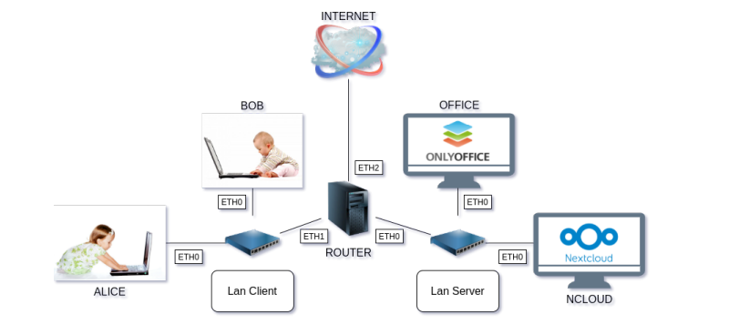

# Nextcloud Infrastructure Deployment

This project documents the full configuration and deployment of a Debian-based virtual network infrastructure hosting a Nextcloud server with OnlyOffice integration.

## Overview

The infrastructure consists of a multi-subnet network simulated using NEmu/Filius, featuring:
- **Router**: Debian-based gateway connecting two subnets.
- **ncloud**: Nextcloud server for file storage and collaboration.
- **office**: OnlyOffice Document Server integration.
- **Clients (Alice & Bob)**: Desktop clients configured to access the services.

## Network Architecture

The network is divided into two /24 subnets:
- **Subnet A (192.168.0.0/24)**: Client network (Alice, Bob).
- **Subnet B (192.168.1.0/24)**: Server network (ncloud, office).

### Addressing Plan
| Machine | Interface | IP Address | Gateway |
|---------|-----------|------------|---------|
| Alice   | eth0      | 192.168.0.10 | 192.168.0.30 |
| Bob     | eth0      | 192.168.0.20 | 192.168.0.30 |
| Router  | eth0      | 192.168.0.30 | - |
| Router  | eth1      | 192.168.1.30 | - |
| ncloud  | eth0      | 192.168.1.10 | 192.168.1.30 |
| office  | eth0      | 192.168.1.20 | 192.168.1.30 |

## Features & Configuration

### 1. Infrastructure Setup
- **Static IP Configuration**: Persistent network settings via `/etc/network/interfaces`.
- **IP Forwarding**: Router configured to allow traffic between subnets.
- **SSH Access**: Remote management enabled across the network.

### 2. Nextcloud Services
- **Nextcloud Server**: Core collaboration platform.
- **OnlyOffice Integration**: Real-time document editing.
- **Security**: 2FA (Two-Factor Authentication) and hardened configuration.
- **Plugins**:
    - **Passwords**: Secure password management.
    - **Draw.io**: Diagramming tool integration.
    - **Calendar & FormVox**: Productivity and survey tools.

## Getting Started

### Prerequisites
- Debian GNU/Linux
- NEmu / Filius (for network simulation)
- VirtualBox or QEMU/KVM

### Deployment Steps
1. **Load the Simulation**: Open `FiliusSchem.fls` in Filius.
2. **Network Config**: Apply static IPs as defined in the addressing plan.
3. **Enable Routing**: Run `echo 1 > /proc/sys/net/ipv4/ip_forward` on the router.
4. **Service Install**: Follow the detailed commands in `Wiki.md` to install Apache, MariaDB, PHP, and Nextcloud on the `ncloud` machine.

## Documentation
For a step-by-step installation tutorial, command-line references, and troubleshooting, please refer to the full [Wiki.md](Wiki.md).

---
**Team:**
- **Khanthavilayraksa Sonesay**: Network setup & Server configuration.
- **Lableigne Thomas**: Documentation & System configuration.
