Network Services Installation Tutorial
======================================

Table of contents
-----------------

- [Network Services Installation Tutorial](#network-services-installation-tutorial)
  - [Table of contents](#table-of-contents)
    - [Introduction :](#introduction-)
    - [Network and system configuration :](#network-and-system-configuration-)
      - [User management](#user-management)
      - [Local Network Administration](#local-network-administration)
      - [Dynamic Configuration](#dynamic-configuration)
      - [Static Configuration](#static-configuration)
    - [Server Installation and Configuration](#server-installation-and-configuration)
      - [NextCloud Service Installation](#nextcloud-service-installation)
      - [Security Configuration](#security-configuration)
      - [Two-Factor Authenticator](#general-configuration)
      - [General Configuration](#general-configuration)
    - [OnlyOffice Service](#onlyoffice-service)
    - [NextCloud Plugins](#nextcloud-plugins)
      - [OnlyOffice](#onlyoffice)
      - [Splash](#splash)
      - [Passwords](#passwords)
      - [Secrets](#secrets)
      - [Draw.io](#drawio)
      - [Calendar](#calendar)
      - [FormVox](#formvox)
      - [Additional Plugins](#additional-plugins)
    - [Installing and Configurating clients](#installing-and-configurating-clients)

 
 

> ### Team Presentation : {#team-presentation}
> - **Khanthavilayraksa Sonesay**
> Role: Network setup, server configuration, testing.  
> 
> - **Lableigne Thomas** 
> Role: Documentation, system configuration, client >integration.

### Introduction :
This tutorial describes the full configuration of a Debian-based virtual network hosting a Nextcloud server with OnlyOffice integration, plus a configured heavy client.   All steps are clearly outlined with commands, configuration blocks, and required screenshots.

> **Tools Used :**
>
> - Debian GNU/Linux
>
> - Nextcloud
>
> - OnlyOffice
>
> - VirtualBox or QEMU/KVM
>
> - Markdown for documentation

### Network and system configuration :

We will be working on the following network :

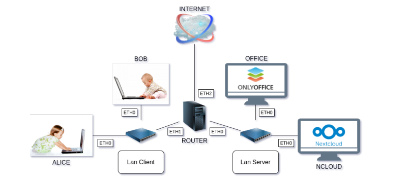

> **Let's get started**
>  
> Start the virtual network as shown above. A window corresponding to the router machine's console should appear.   For now, only this machine is started.   The cli() command in NEmu's main terminal will start both the Alice and Bob machines, while the srv() command in NEmu's main terminal will start the ncloud and office machines.

 

#### User management

> **Identification**
>  
> Use the login "root" and the password "plop" to successfully identify yourself as the super user.

 

> **Create yourself**
>  
> Use the following command :
> - adduser (login)
>
> This'll allow us to create a new user. We will need it later.
> For password, you can use the same as your login. For the rest of the information, press the button "enter" in order to skip.

 

> **Let's take control**
>  
> Use the following command in order to log into your account :
> - login (login)
>
> If it works, congratulations, you've made it to the next step of the operation.

 

> **Back as a boss**
>  
> Log back into the root account, using this simple command to quit yours :
> - exit

 

> **Let's make connections**
>  
> Add your new user to the sudo group using the usermod command, in order to allow your user to execute privileged commands without needing to know the root password, by using this simple command :
> - usermod -a -G sudo (login)
>  
>
> *Explanation if you're not lazy to read :*  
> 
> usermod = modifies a user account.
> -a = appends the user to the group(s) (used with -G).
> -G = specifies the group(s) to add the user to.
> sudo = the group the user is added to.

 

> **Time to see if everything's working like a watch**
>  
> Verify if the user is indeed in desired group with the following commands :
> - id (login)
> - sudo whoami

 

> **Question : How does sudo work?**
>  
> - sudo 
> 
> Allows a permitted user to run commands with superuser (root) privileges by temporarily elevating their access, typically after entering their own password (not root’s). It uses the /etc/sudoers file to define who can run what.

 

#### Local Network Administration

 

> **Addressing Plan**
>  
> *Read if not lazy* :
> As you can see in the network diagram, the ncloud and office machines are connected to the same switch, while alice and bob are on a different switch. The two switches are connected through the router machine. The goal here is to create two /24 subnets, one for each switch.
> > **Question : How can a /24 network be characterized?**
> >  
> > A /24 network means that the first three bytes are fixed. This allows for 254 machines in a subnet. The first address is reserved for the router, and the last one is used for broadcast.

 

> **Configure the network by giving the IP addresses as follows on this image :**
>  
> 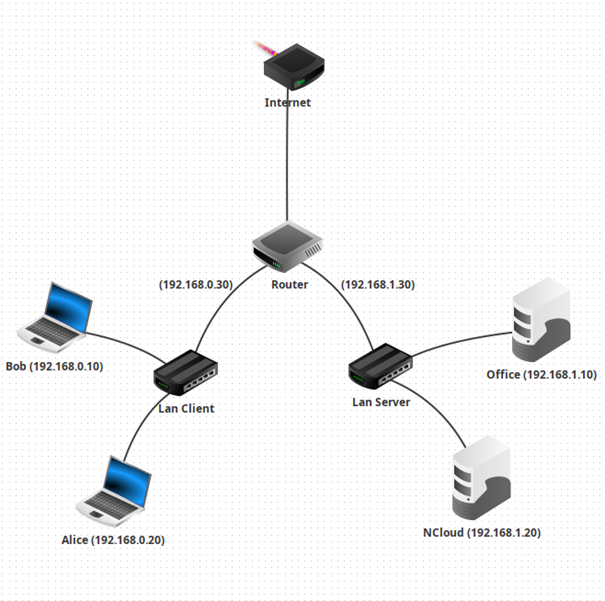

 

#### Dynamic Configuration

>  
> 
> **Let's dive into this**
>  
> > **Setting things up**
> >  
> > *Read if not lazy :*
> > The 
> > - ifconfig 
> >
> > command allows you to view the active interfaces on a machine. The commands 
> > - ifconfig -a 
> > *and*
> > - ip -br addr 
> >
> > let you see all of a machine’s interfaces. Use these commands to view all network interfaces on each machine.
>  
> ---
> > **What is 127.0.0.1?**
> >  
> > The **lo** interface is the loopback interface used for internal communication within the machine. The address **127.0.0.1** represents the machine itself (localhost), in other words, it's us.
>  
>
> -----
> 
> > **Time to work** 
> >  
> > Assign the IP addresses using the ifconfig or ip command (both commands will produce the same result; you can use whichever you prefer):
> > - ifconfig eth0 192.168.0.10 netmask 255.255.255.0
> > - ifconfig eth0 up
> > *or*
> > - ip addr add 192.168.0.10/24 dev eth0 && ip link set eth0 up
> >
> > *Explanaition if you're the curious type :*
> >  
> > *First command, ifconfig eth0 192.168.0.10 netmask :*
> > 
> > ifconfig = command used to configure network interfaces
> >
> > eth0 = the name of the network interface (usually the first Ethernet adapter)
> >
> > 192.168.0.10 = the IP address you want to assign to the interface
> > netmask = keyword to specify the subnet mask (you must follow it with the actual mask, e.g., 255.255.255.0)
> >  
> > 
> > *Second command (it's too long for a lazy guy like me)*
> > 
> > ip = modern command to manage networking (replaces ifconfig)
> >
> > addr add = adds a new IP address to an interface
> >
> > 192.168.0.10/24 = the IP address with subnet ("/24" means subnet mask 255.255.255.0)
> >
> > dev eth0 = specifies the device (network interface) to configure
> >
> > && = runs the next command only if the previous one succeeds
> >
> > ip link set eth0 up = activates (turns on) the interface eth0 so it starts working
> >  
> > 
>  -------
> > **Can't continue praying that you did everything right, time to see if it's actually the case**
> >  
> > Test your configuration using the ping command between machines on the same subnet with this command :
> > 
> > - ping 192.168.0.20 (From Bob to Alice (same subnet))
> > 
> > At this stage, inter-subnet communication is not yet possible because the router discards packets that are not directly addressed to it.
> >
> <!-- THIS IS QUESTION 16? I JUST LEARNED HOW TO COMMENT -->
> -----
> > **Enable routing on the router**
> >  
> > Use this command : 
> > - echo 1 > /proc/sys/net/ipv4/ip_forward
> > 
> > This allows the Linux kernel to forward packets between network interfaces.
> > 
> > *PS : if you ask yourself what kernel is, I've got you below*
> > The kernel is the core part of an operating system. It manages the computer’s hardware (like CPU, memory, and devices) and allows software to communicate with it. In short, it’s the bridge between applications and the physical machine.
> >  
>  <!-- QUESTION 17 -->
>  ----
> > **Question : Why can’t ncloud and alice communicate yet?**
> >  
> > Because they don’t know how to reach the other subnet. They are missing a default route pointing to the router.
> >  
> <!-- QUESTION 18 -->
> -----
> > **Set a default gateway**
> >  
> > On ncloud and Office :
> > - ip route add default via 192.168.1.30
> > 
> > On Alice and Bob:
> > - ip route add default via 192.168.0.30
> > 
> > Use route -n to view the kernel's IP routing table at any time
> >
> > *PS : If you encounter errors at this stage, where Alice and ncloud can communicate with the router but not with each other—redo step 16.*
> >  
> ----
> > **Test with ping and ssh**
> >  
> > From Alice :
> > - ping 192.168.1.10         (to Office)  
> >
> > *(if the SSH service is active)* :
> > - ssh user@192.168.1.10 
> >  
> -----
> > **Trace the route with traceroute**
> >  
> > On Alice : 
> > - traceroute 192.168.1.20
> >
> > This shows the different hops taken, mainly the router in this case.
> >  
> > 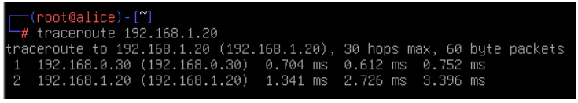
> >  
> ----
> <!--QUESTION 21-->
> > **What do you observe after a reboot?**
> >  
> > We observe that the interfaces lose their IP configuration, the default routes are cleared, and the configurations must be reapplied manually.
> >  
 

#### Static Configuration

Commands like route, ifconfig, and ip allow you to make temporary changes, but unfortunately, they do not preserve the configuration after the machine is rebooted. We'll be fixing this in the following.

 

> <!--QUESTION 22-->
>  
> 
> **Time to make things work**
>  
> > **Fix this via /etc/network/interfaces**
> >  
> > - nano /etc/network/interfaces  *(open the correct configuration file)*
> >
> > Add the following lines *(Don't touch anything else if you don't want your PC explode from my magic)*, adjusting the addresses and gateway according to the specific machine (alice, bob, office, ncloud) :
> >
> > auto eth0
> > iface eth0 inet static
> > &nbsp; &nbsp; address 192.168.0.10
> > &nbsp; &nbsp; netmask 255.255.255.0
> > &nbsp; &nbsp; gateway 192.168.0.30
> >  
> ----
> > **Restart the interface after modification**
> >  
> > - ifup --force eth0
> >
> > This applies the interface settings according to the configuration file.
> > 
> > If you get an error like RTNETLINK answers: File exists, it means the settings are already configured. To be sure, you can run:
> > - ifdown eth0
> > - ifup --force eth0
> >  
> --------
> > <!--QUESTION 24-->
> > **Shut down the network interface if needed**
> >  
> > - ifdown --force eth0
> >
> > This forcibly disables the eth0 network interface.
> >  
> -----
> <!--QUESTION 25-->
> > **Verify the configuration is correct**
> >  
> > - ip addr
> > - route -n
> > - ping 192.168.X.X
> >
> > The router should not have a gateway, since it is directly connected to both networks.
> >  
> -----
> > <!--QUESTION 26-->
> > **Enable routing in /etc/network/interfaces on the router**
> >  
> > auto eth0
> > iface eth0 inet static
> > &nbsp; &nbsp; address 192.168.0.30
> > &nbsp; &nbsp; netmask 255.255.255.0
> >
> >  
> >
> > auto eth1
> > iface eth1 inet static
> > &nbsp; &nbsp; address 192.168.1.30
> > &nbsp; &nbsp; netmask 255.255.255.0
> > &nbsp; &nbsp; up echo 1 > /proc/sys/net/ipv4/ip_forward
> >
> > This last line automatically enables packet forwarding at startup.
> >  
> > 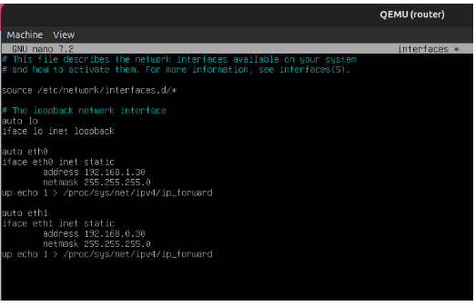
> >  
> ---
> <!--QUESTION 27-->
> > **Verify after starting/stopping the interfaces**
> >  
> > Here are the checks to perform on each machine after configuring the network statically (in /etc/network/interfaces):
> >  
> > *Check the interfaces :*
> > - ip addr
> > - ifconfig
> >
> > *Check the routing table :*
> > - route -n
> > - ip route
> >
> > *Test connectivity :*
> > - ping 192.168.0.10  *(e.g., ping Bob from Alice)*
> > - ping 192.168.1.10  *(ping Office from Bob)*
> > 
> > *Restart or reset the interfaces :*
> > - ifdown --force eth0
> > - ifup --force eth0
> >
> > With those, you'll know that the configuration is correctly applied after reboot, that routing is working, and that machines can communicate with each other (I know it's too good to be true, but it is).
> >
> > Admire the beauty :
> >  
> > 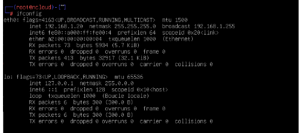
> > 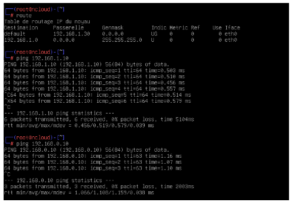

Finally it's over you may think, I would be glad if it was... Heading on towards Server Configuration... 

### Server Installation and Configuration

With the system and network configuration in place, we will now proceed with the installation and configuration of services on the server machines.

#### NextCloud Service Installation

All actions in this section are to be performed on the ncloud machine.

*Lots of reading you must do, obtain the power in order to.*

On Linux, software is typically installed using a package manager, which simplifies installing, updating, or removing software while handling dependencies (other required packages). It works by downloading installation files from remote repositories.

<!--QUESTION 28-->
 
The APT (Advanced Package Tool) is the default package manager used by Debian and its derivatives such as Ubuntu, Linux Mint, and Raspbian. It allows users to install, update, upgrade, and remove software packages from the command line. APT automatically handles dependencies, ensuring that all required packages are installed. It retrieves software from online repositories, making package management efficient and reliable. Common commands include apt install, apt update, and apt upgrade.

<!--QUESTION 29-->
 
 

Different Linux distributions use different package managers:

- Fedora and Red Hat use DNF (Dandified YUM), which is a modern version of the older yum tool.

- OpenSUSE uses Zypper, which manages RPM packages.

- Arch Linux uses Pacman, a lightweight and powerful package manager designed for speed and simplicity.

Each of these tools serves the same purpose as APT: to install, update, and manage software and dependencies from official repositories.

<!--QUESITON 30-->
 
 

Each package manager supports a specific package format:

- APT (Debian, Ubuntu, etc.) → uses .deb (Debian package) files

- DNF / YUM (Fedora, Red Hat) → uses .rpm (Red Hat Package Manager) files

- Zypper (OpenSUSE) → also uses .rpm files

- Pacman (Arch Linux) → uses .pkg.tar.zst (compressed package archives specific to Arch)

These formats contain the software, metadata, and instructions for installation.

 
 
<!--QUESTION 31-->
**Question : Are there any package managers in the Windows world? If so, which one(s)?**

**Yes**, Windows also has package managers. The most notable ones are:

- Winget (Windows Package Manager) – the official tool from Microsoft for installing software via the command line.

- Chocolatey – a popular third-party package manager that supports a wide range of applications and tools.

- Scoop – a lightweight package manager focused on developer tools and command-line utilities.

These tools allow Windows users to install, update, and manage software packages in a way similar to Linux systems.

 
 
<!--QUESTION 32-->
**Question : Are there any package managers in the macOS world? If so, which one(s)?**

**Yes**, macOS also has package managers. The most popular ones are:

- Homebrew – the most widely used package manager for macOS, allowing easy installation of open-source software and command-line tools.

- MacPorts – another package manager for installing and managing open-source software.

- Fink – less common, but also used to bring Unix software to macOS.

These tools bring Linux-like package management to macOS, making it easier to install and manage software via the command line.

 
 
<!--QUESTION 33-->
⚠️ &nbsp; **Careful, useful information ahead :** ⚠️
(just in case you were skipping all the annoying text)

Use those if you need to :

**Update** the list of available packages
- sudo apt update

**Search** for a package
- apt search (package-name)

**Display** details about a package
- apt show (package-name)

**List all** installed packages
- apt list --installed

**Install** a package
- sudo apt install (package-name)

**Remove** a package
- sudo apt remove (package-name)

**Upgrade** all installed packages
- sudo apt upgrade

*PS : in actual terminal use, you should type the real name without parentheses. The parentheses here are for clarity, not syntax.*
 
 

Nextcloud has many dependencies, making its manual installation complex as shown in the [official documentation](https://docs.nextcloud.com/server/latest/admin_manual/installation/source_installation.html)

Snap is a special package manager that simplifies this process by bundling the software and all its dependencies into a single package.
Applications installed via Snap run in a restricted environment, offering better protection against potentially harmful actions.
 
 

<!--QUESTION 34-->
**Install the snapd package using apt.**
 
- sudo apt install snapd

This installs the Snap package manager, allowing you to download and manage Snap packages.

<!--QUESTION 35-->
 

**As with apt, here are the typical snap commands**
 
**Search** for a package
- snap find (package-name)

**Install** a package
- sudo snap install (package-name)

**List** installed Snap packages
- snap list

**Update** a package
- sudo snap refresh (package-name)

**Remove** a package
- sudo snap remove (package-name)

<!--QUESTION 36-->
 

**Install Nextcloud via Snap as shown in the [documentation](https://docs.nextcloud.com/server/latest/admin_manual/installation/source_installation.html#installing-via-snap-packages)**

 
 
<!--QUESTION 37-->

**To complete the Nextcloud service installation, you will need a web browser**
 

To access one, switch to graphical mode using the command :
- startx

You are now in the XFCE desktop environment.
If needed, you can change the virtual machine’s screen resolution through the main menu on the desktop.

 
 
<!--QUESTION 38-->
**Open a web browser and connect to your Nextcloud service using its LAN Server IP address**
 

If you accidentally connected using the local address (i.e., 127.0.0.1), update the configuration with the following commands:

- snap set nextcloud listen.http=(IP address)
- snap run nextcloud.occ config:system:set trusted_domains 1 --value=(IP address)
- snap restart nextcloud

*PS : Replace (IP address) with the actual IP of the machine on the LAN*

You should obtain something like this : 
 

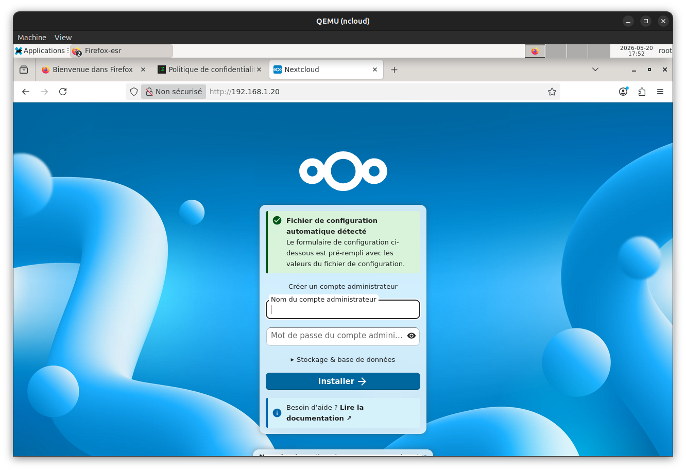
 
 

**Choose a username and password for the administrator account**
 

These credentials will be used to log in to the Nextcloud web interface with full access rights.

 
 
<!--QUESTION 40-->

**Log in to the service using your administrator account**
 

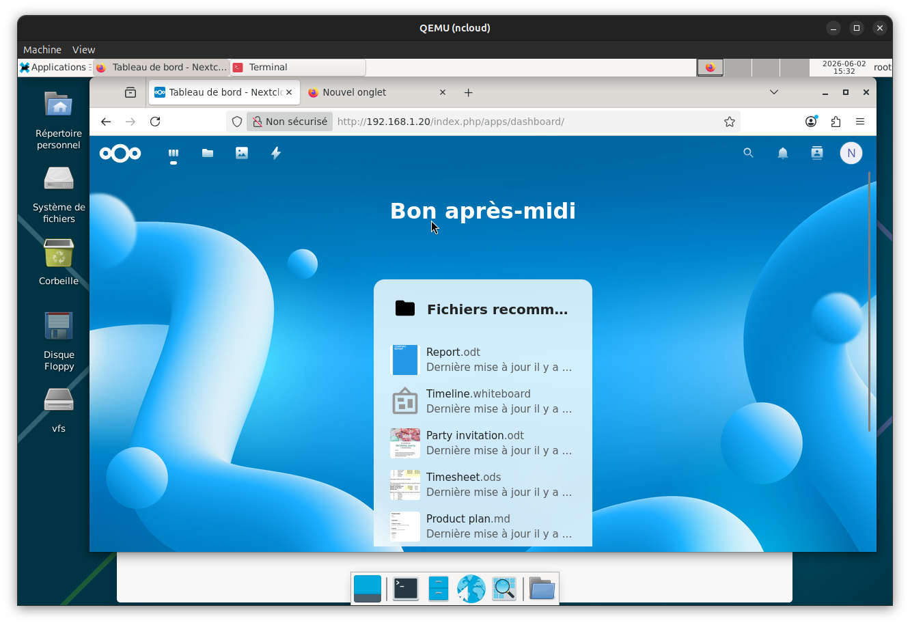

During the first login, do not install the recommended apps in order to keep a minimal and lightweight installation.

 
 

#### Security Configuration

Go to the administration settings and observe that several security alerts are present.
Here, we will focus only on the most important ones (i.e., those marked in red and orange).

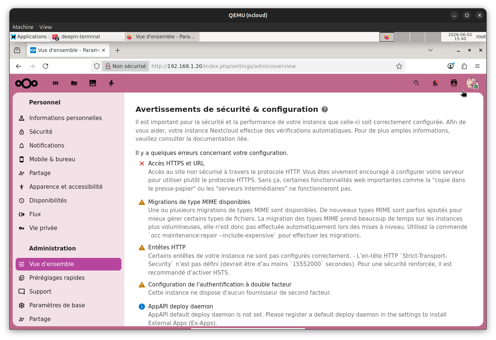

 
<!--QUESTION 41-->
 

**The second point concerns file mimetypes**
 
A mimetype (short for Multipurpose Internet Mail Extensions type) is a way to identify the type and format of a file transmitted over the internet.
It tells the system or browser how to handle a file, based on its content (e.g., whether it should be opened as text, image, video, etc.).

Example:

- text/html → HTML document

- image/png → PNG image

- application/pdf → PDF file

Nextcloud uses mimetypes to correctly classify and manage uploaded files. Misconfigured mimetypes can affect security or functionality.

 
<!--QUESTION 42-->

**To fix this configuration issue, run the following command**
 
- snap run nextcloud.occ maintenance:repair --include-expensive

This performs a thorough system repair, including checks for file mimetypes and other advanced issues.
 

The two other critical issues relate to the connection method used to access our web service.
 

Currently, no encryption is in place, meaning our data is not protected during transmission.
 

To fix this, we need to switch from the HTTP protocol to the HTTPS protocol, which provides secure and encrypted communication.

 

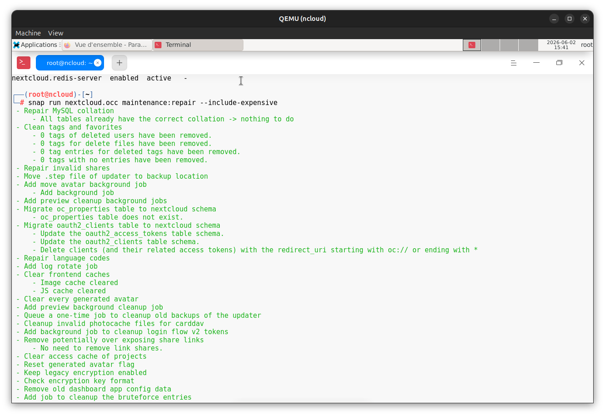

 
<!--QUESTION 43-->
**Useful information** 
 

*What is HTTPS and how does it work?*

HTTPS (HyperText Transfer Protocol Secure) is the secure version of HTTP. It ensures confidentiality, integrity, and authenticity of data exchanged between a client (like a browser) and a server.

It works by encrypting the connection using SSL/TLS protocols and relying on digital certificates to authenticate the server.

 

🔐 SSL/TLS Protocol
- TLS (Transport Layer Security) is the current standard (SSL is the outdated predecessor).

- It encrypts the connection using asymmetric encryption to exchange keys, then uses symmetric encryption for fast, secure data transmission.

- TLS ensures that no third party can read or modify the exchanged data.

 

📄 X.509 Certificates
- A digital certificate that follows the X.509 standard.

- It contains information like:

  - The server’s public key

  - The server’s identity (domain, IP, etc.)

  - The issuer (Certification Authority)

  - A digital signature from the authority

 

🏛️ Certificate Authorities (CAs)
- Trusted third parties that verify the identity of certificate requesters.

- They sign certificates to confirm that the public key really belongs to the given server.

- Browsers trust certificates only if they are signed by a trusted CA.

 

🧾 Self-Signed Certificates
- A certificate signed by the server itself, not a CA.

- Provides encryption, but not trust (browsers show a warning because identity is not verified).

- Useful for testing, internal networks, or private servers.

 

<!--QUESTION 44-->

**Using the following command, we will generate a TLS certificate and its private key, both required to switch our Nextcloud service to the HTTPS protocol**
 

👉 Be sure to replace (Server IP) with the actual IP address of the ncloud server (I didn't replace it myself as you may have chosen another address) :

- cd /var/snaps/nextcloud/53305/
- certgen -common-name 192.168.1.20  -host 192.168.1.20

This command:

- Creates a cryptographic key and an SSL/TLS certificate tied to the local IP address 192.168.1.20

>
>- public.crt: The public certificate (the one sent to web browsers)
>
>- private.key: The private key (which must remain secure and is used to encrypt connections).

 
<!--QUESTION 45-->
**Now enable the HTTPS protocol for Nextcloud by running the following command:**
 
- snap run nextcloud.enable-https custom -s public.crt private.key public.crt

 

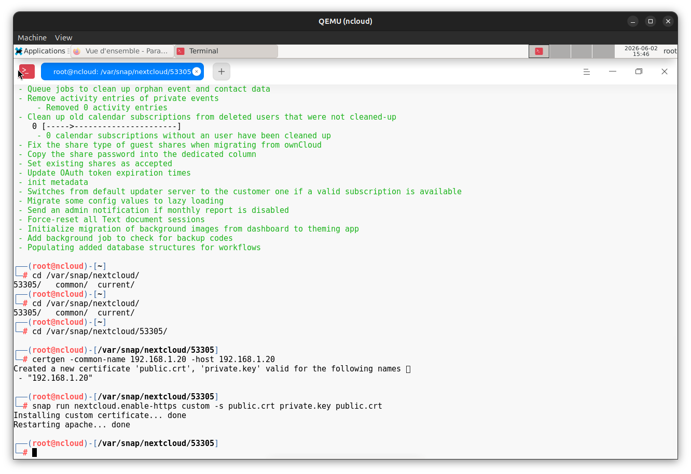
 
<!--QUESTION 46-->

**Reconnect to the Nextcloud service and notice that you are now using the HTTPS protocol, but a security warning is displayed**
 

This warning appears because you are using a **self-signed certificate**, which is not issued by a trusted Certificate Authority (CA).  
Browsers display a warning because they cannot verify the authenticity of the server.

 
<!--QUESTION 47-->

**Add an exception to bypass the warning**
 

To continue, click on the "Advanced" button in your browser and choose "Accept the risk and continue" (wording may vary depending on the browser).

This tells the browser to *trust the self-signed certificate* for this session or permanently, removing the security alert.
 

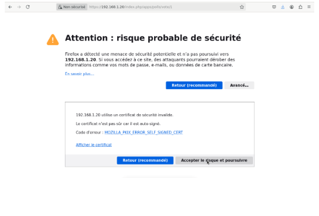

 
<!--QUESTION 48-->

**Research the concepts of MFA, 2FA, and specifically the TOTP method.**
 
### Multi-Factor Authentication (MFA) & Two-Factor Authentication (2FA)

* **2FA (Two-Factor Authentication):** A security process where a user provides two different authentication factors to verify themselves (e.g., something you know like a password + something you have like a phone).
* **MFA (Multi-Factor Authentication):** A broader term that requires **two or more** verification factors. 2FA is a specific subset of MFA.

### The TOTP Method (Time-Based One-Time Password)

TOTP is an algorithm that computes a time-sensitive, single-use passcode (usually 6 digits) using a shared secret key and the current time. 

* **How it works:** 1. The server and the user's authenticator app (e.g., Google Authenticator, Bitwarden) share a secret key (often transmitted via a QR code during setup).
    2. Both sides use the current Unix timestamp (grouped into 30-second intervals) combined with the secret key to generate a unique code.
    3. Because it relies on time synchronization, the passcode automatically changes every 30 seconds, making it highly secure against replay attacks.

 

 
<!--QUESTION 49-->

**A few examples of applications that can manage this mechanism from your phone.**

 

To manage **TOTP-based two-factor authentication** on a smartphone, several reliable applications are widely used across Android and iOS platforms:

* **Google Authenticator:** A simple, lightweight, and very popular option that supports cloud backups via a Google account.
.svg.png)

* **Microsoft Authenticator:** A robust application heavily used in corporate environments, offering cloud sync, PIN/biometric protection, and push notifications for Microsoft accounts.

 

 
<!--QUESTION 50-->

**Please be sure to have an authenticator installed on your mobile device before doing the next questions**

 
 
<!--QUESTION 51-->

**Active the Two-Factor TOTP Provider Plugin in your app**

Go to:

App>Your App

Under the **Disabled apps** section or by using the search bar, look for **Two-Factor TOTP Provider**.
Click **Enable** to activate the plugin for the entire system.

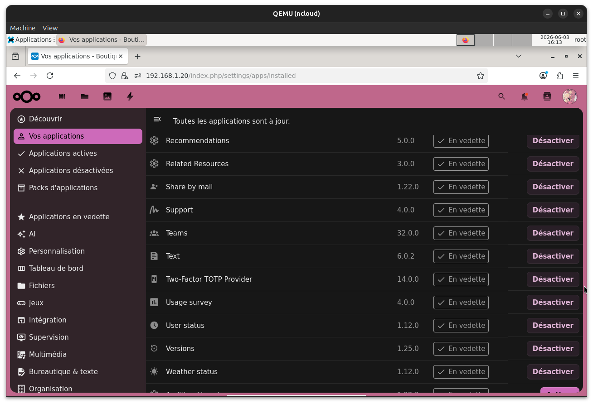
 

<!--QUESTION 52-->

**Enable TOTP two-factor authentication for your administrator account and ensure it works properly.**

Go to:

Personal settings > Security

Locate the **Two-factor authentication** section and check the box next to **Enable TOTP**.

Open your smartphone's authenticator app and **scan the QR code** displayed on your screen (or manually enter the secret text key).

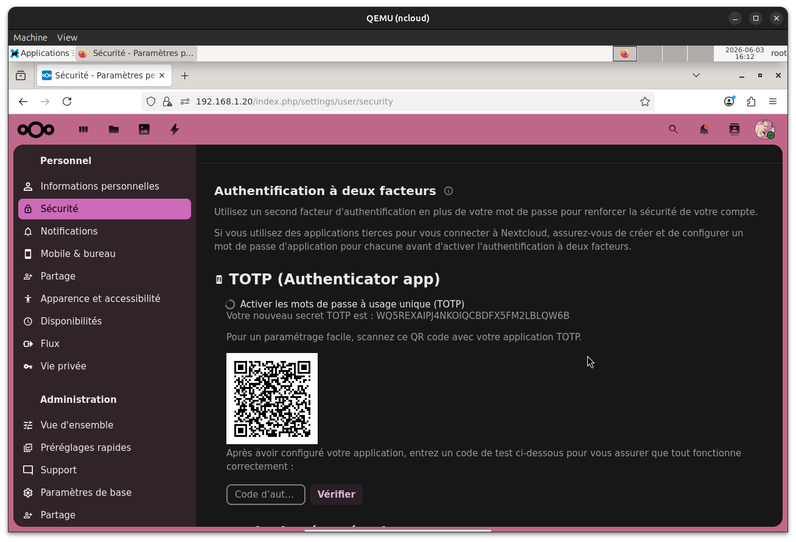

Enter the temporary 6-digit verification code generated by your phone into Nextcloud to confirm the binding.

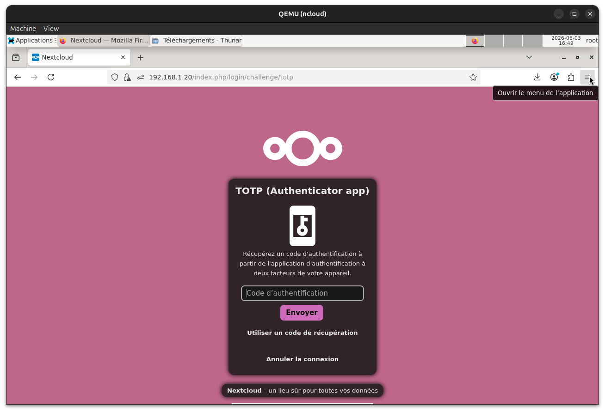

> **Verification:** To test the setup, log out of your administrator account and log back in. After entering your standard username and password, Nextcloud will successfully prompt you for your temporary 6-digit TOTP token.

 

 

<!--QUESTION 53-->
**Also generate recovery codes in case of TOTP data loss and ensure they work properly (I promise no more things about TOTP after that)**
 

To prevent locking yourself out of your server if you lose your phone, you must generate static backup codes:

1. Remaining in the **Personal settings > Security** section of your admin account, look for **Backup codes**.
2. Click on **Generate backup codes**.
3. Download or copy the list of generated single-use strings and store them in a secure place.

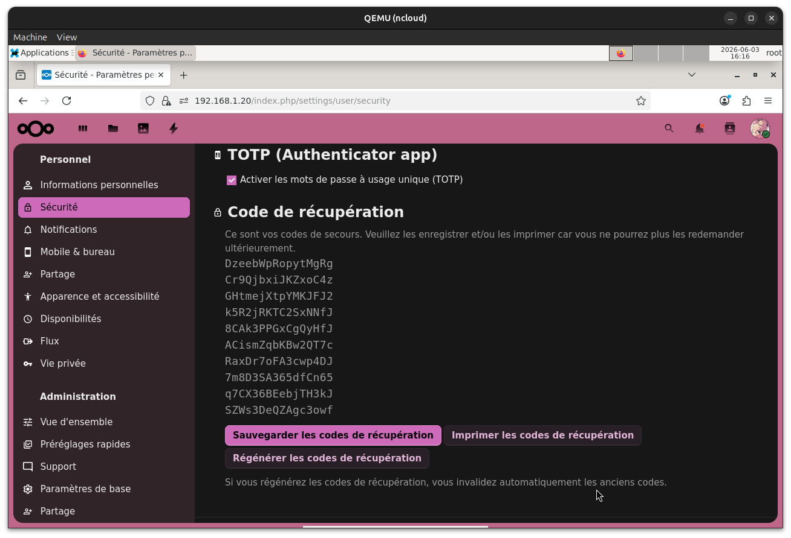

> **Verification:** To test their validity, attempt a fresh login. When prompted for the 6-digit TOTP phone app token, select the alternative login option to use a backup code, enter one of your saved alphanumeric recovery strings, and confirm that you successfully bypass the mobile device check.

 

#### General Configuration

 

 
<!--QUESTION 54-->

**Now that the service is installed (yey finally), we will move on to general configuration**

 

To allow users to share specific files with people who do not have a Nextcloud account,  
configure the settings so that public share links can only be created with a password.

Go to:  
Settings > Sharing  
and enable:  
- Enforce password protection for public links

This ensures that any external share must include a password for better security.

 

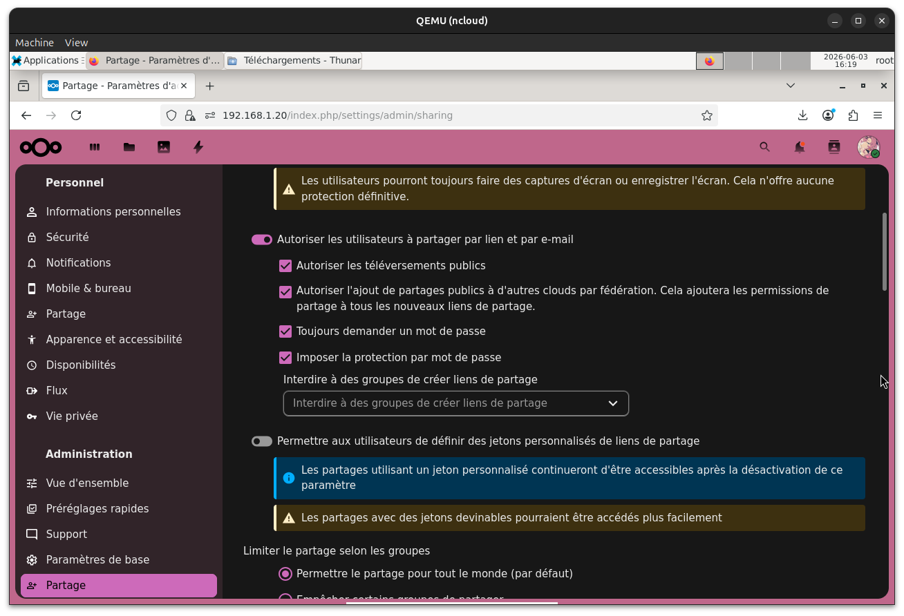

 
<!--QUESTION 55-->

**Strengthen the password policy**
 

Enforce stricter password rules to improve account protection:

In Settings > Security:
- Require at least one lowercase letter, one uppercase letter, and one number
- Enable password checking against the [Have I Been Pwned](https://haveibeenpwned.com/) database to block compromised passwords

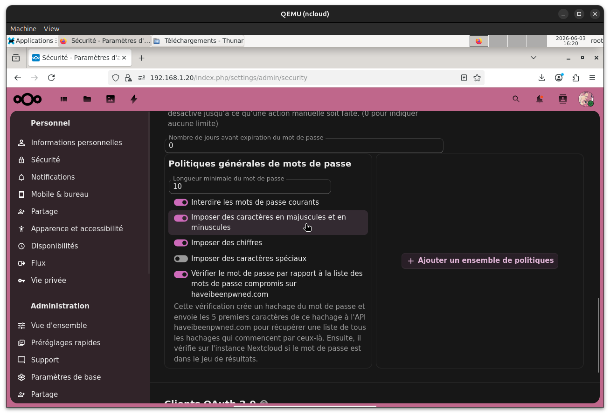

These settings help prevent weak or reused passwords from being used on your Nextcloud instance.

 
<!--QUESTION 56-->

**What is the Have I Been Pwned service?**
 

Have I Been Pwned is an online service that allows users to check if their email address or passwords have been involved in known data breaches.  
 

It maintains a database of billions of compromised credentials collected from leaked databases.  
 

Nextcloud can use this service to detect and block insecure passwords during account creation or password updates.

You can visit the official site to check your own email address:
- https://haveibeenpwned.com/

 
<!--QUESTION 57-->

**Create a user group named IUT**
 

In the Nextcloud web interface:

1. Go to the user management panel  
2. Click "Add group"  
3. Enter the group name `IUT` and confirm

This group can then be used to assign shared folders, permissions, or policies.

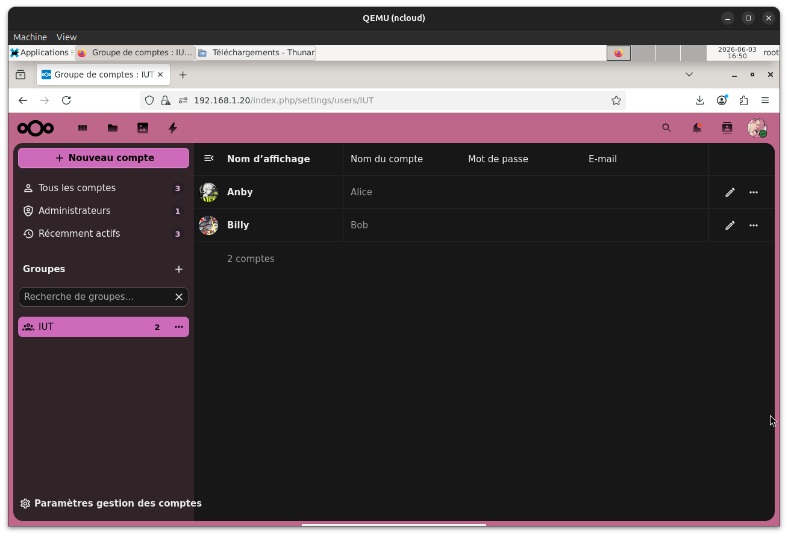

 
<!--QUESTION 58-->

**Create a user named alice with admin rights over the IUT group and a storage quota of 5 GB**
 

In the Nextcloud web interface:

1. Go to the user management panel  
2. Click "Add user"  
3. Fill in the following fields:
   - Username: `alice`
   - Password: (choose a secure one)
   - Group: check `IUT`
   - Quota: set to `5 GB`
   - Email: leave blank
4. After creation, assign `alice` as group admin:
   - In the list of users, click the gear icon or dropdown next to `alice` and check *Group admin for IUT*

 

Here's what it should look like : 
 

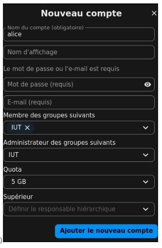

 
<!--QUESTION 59-->

**Create a user named bob without admin rights and with a storage quota of 1 GB**
 

In the Nextcloud web interface:

1. Go to the user management panel  
2. Click "Add user"  
3. Fill in the following fields:
   - Username: `bob`
   - Password: (choose a secure one)
   - Group: optional (you can add to `IUT` if desired)
   - Quota: set to `1 GB`
   - Email: leave blank

bob will be a standard user without administrative privileges.

 

Here's what it should look like : 

 

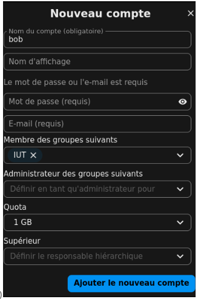

 

 
<!--QUESTION 60-->

**Log out from the administrator account and log in successively as alice, then bob**

Customize their display name and profile picture.

 

Steps to follow for each user:

1. Log in with the corresponding username and password  
2. In the top-right corner, click the user icon, then select *Settings*  
3. Change the display name (e.g., Alice or Bob)  
4. Upload a profile picture by clicking on the avatar circle

Repeat these steps for both users to personalize their accounts.

 

Here's my customization :

 

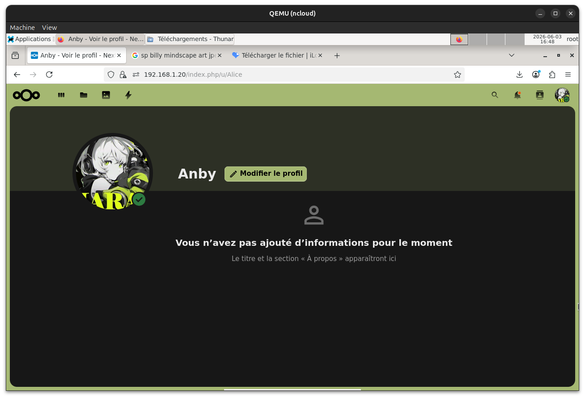

 

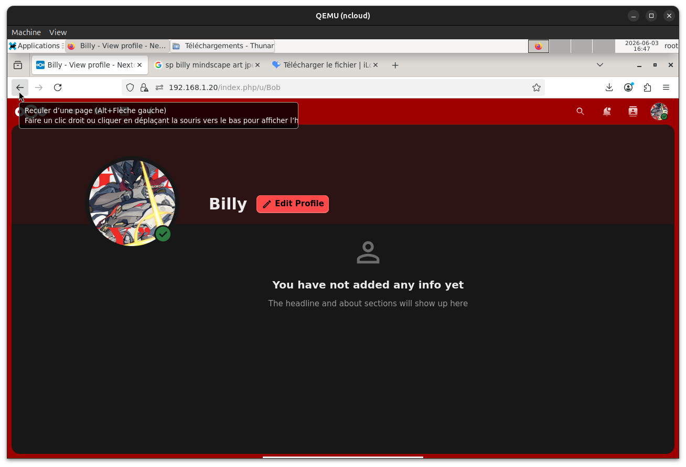

 
<!--QUESTION 61-->

**From the alice account, create a shared folder that allows all users in the IUT group to have read and write access** 

Verify that it works correctly using the bob account.
 

Steps:

1. Log in as `alice`  
2. Create a new folder from the *Files* interface (e.g., name it `Shared-IUT`)  
3. Click the share icon (right side of the folder)  
4. In the sharing field, enter `group: IUT`  
5. Ensure the option *Can edit* is enabled for the group

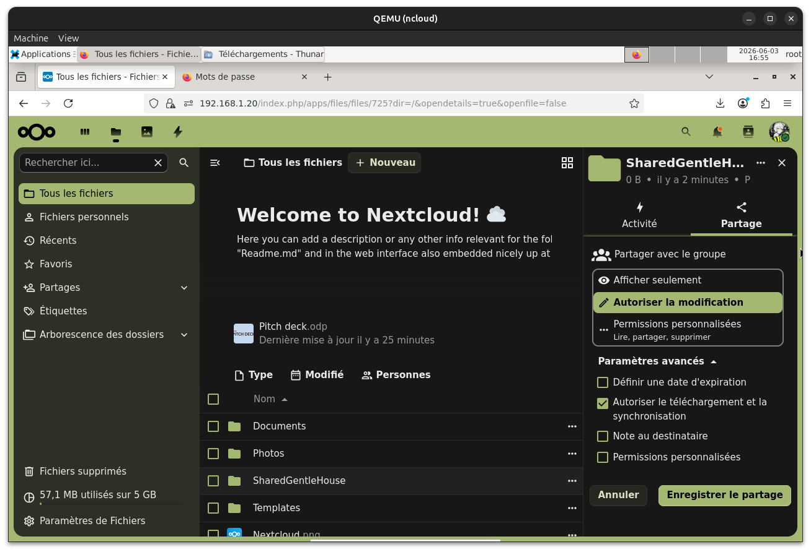

Then:

1. Log out and log in as `bob`  
2. Navigate to the *Files* section  
3. Confirm that the `Shared-IUT` folder is visible and that bob can create, modify, or delete files within it

 

 

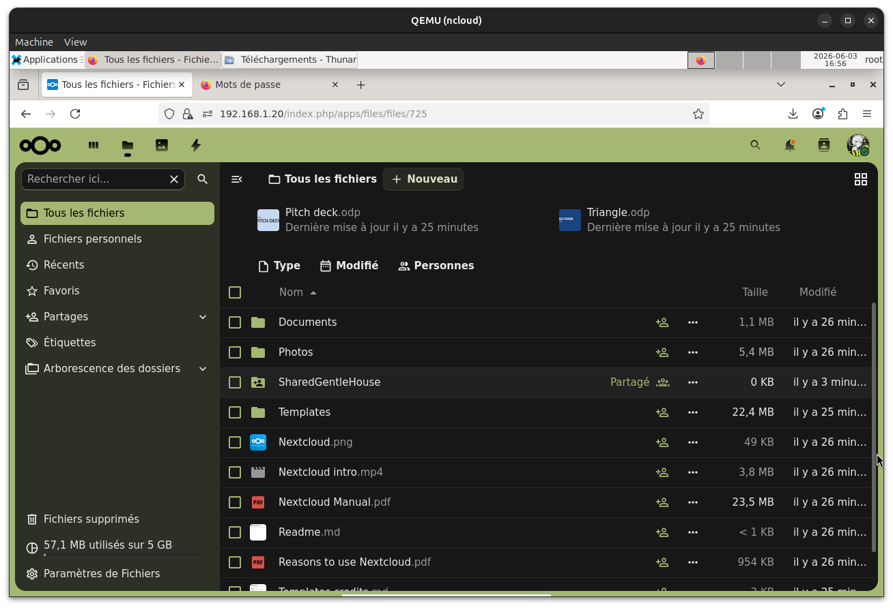
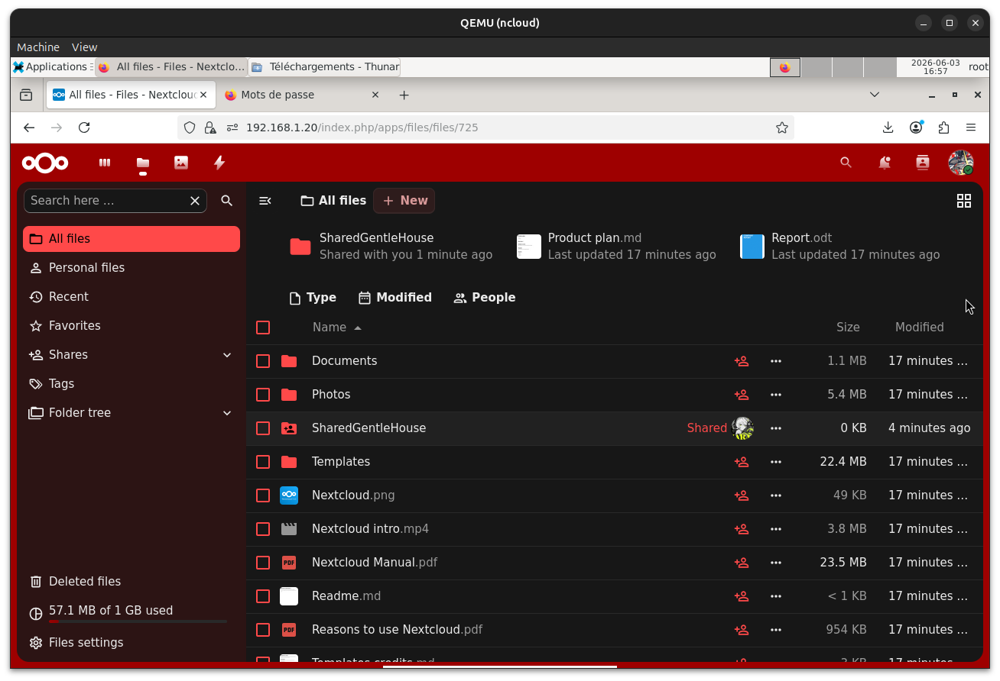

 
<!--QUESTION 62-->

**From the alice account, generate a public share link to a file, protected by a password**  

Verify that the file is accessible without being logged into a Nextcloud account.
 

Steps:

1. Log in as `alice`  
2. Upload or choose any file from the *Files* section  
3. Click the share icon next to the file  
4. Enable *Share link*  
5. Set a password for the public link  
6. Copy the generated link

To test:

1. Open a private/incognito browser window  
2. Paste the link into the address bar  
3. Confirm that the file is only accessible after entering the correct password  
4. You should not be prompted to log in to any account

 

Images : 

 

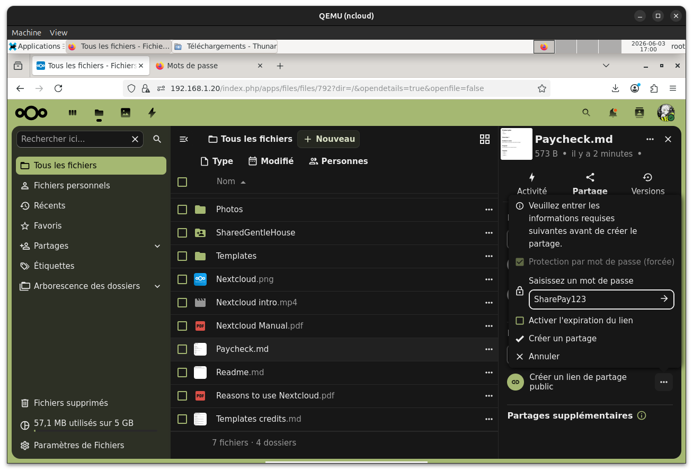
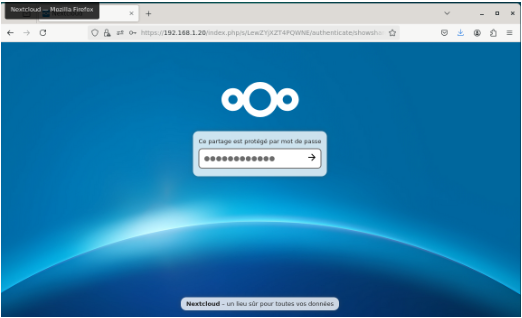

 
<!--QUESTION 63-->

**On one of the user accounts, open a document file (e.g., docx, odt) and observe that it cannot be directly edited from the interface**
 

Steps:

1. Log in as either `alice` or `bob`  
2. Upload a `.docx` or `.odt` file to your files  
3. Click on the file to open it  

You will notice that the file opens in preview mode only, without any editing options. 
  
This is because Nextcloud Office or Collabora Online is not yet installed and configured.

*PS : For me there were no editors, so I couldn't open a docx or odt yet*

 

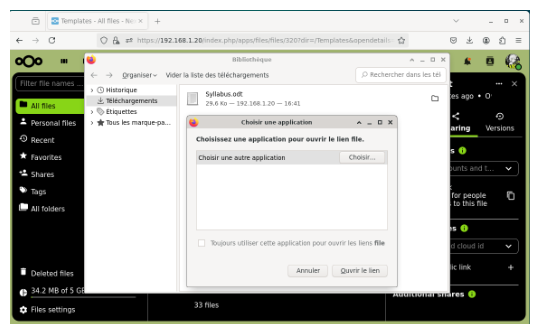

### OnlyOffice Service

 
<!--QUESTION 64-->

All actions in this section will be performed on the office machine.

OnlyOffice is a web service that provides an online alternative to Microsoft Office or LibreOffice, directly in the browser, similar to Office 365.  
 
To avoid overloading the ncloud server, this service will be installed on the office server and connected to Nextcloud via a plugin.

**Install the onlyoffice-ds service via snap on the office server**
 

Use the following command :
- sudo snap install onlyoffice-ds

*PS : You need to go to the Office machine, run sudo apt update, then install Snap with sudo apt install snapd, and finally install OnlyOffice using sudo snap install onlyoffice-ds*

 

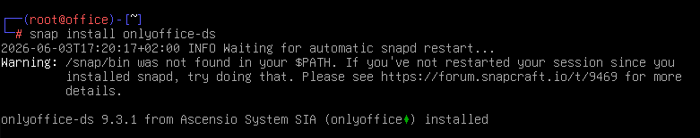
 
<!--QUESTION 65-->

**Get the secret key (referred to as (secret)) that will protect access to the OnlyOffice service**
 

This secret will be used to **authenticate communication** between Nextcloud and OnlyOffice.

- snap get onlyoffice-ds onlyoffice.jwt-secret

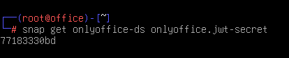

 
<!--QUESTION 66-->

**Enable editing on distant documents**
 

- snap set onlyoffice-ds onlyoffice.use-unautorized-storage=true

 

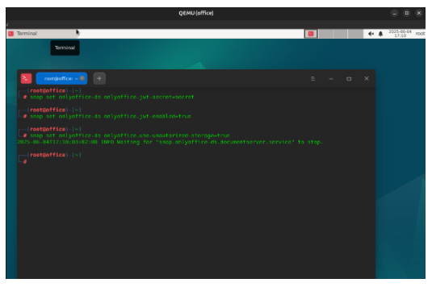

 

 
<!--QUESTION 67-->

**Open a web browser and connect to your OnlyOffice service using its IP address on the LAN server**  

If you see a presentation or welcome page, the installation is working correctly.

 

At this point, there is still *no encryption* securing communication between the Nextcloud server and the OnlyOffice server.  
 

To fix this, we will also enable the *HTTPS protocol* on the OnlyOffice service.

 

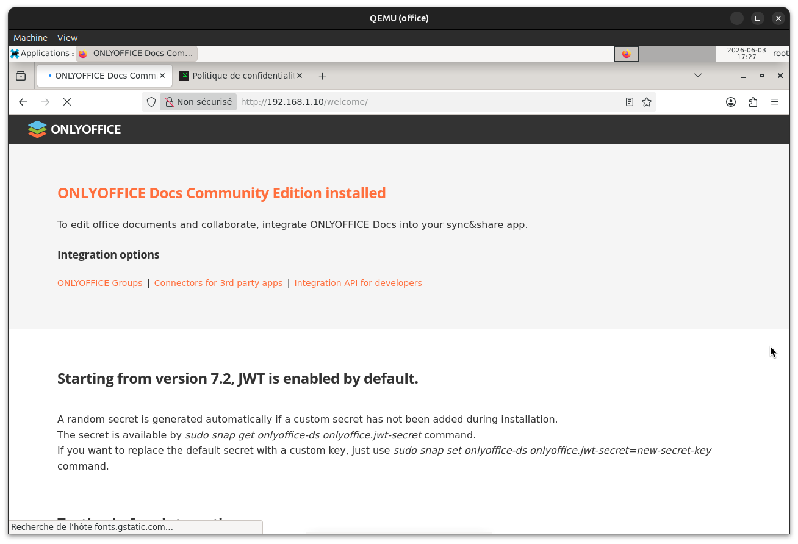

 
<!--QUESTION 68-->

**Generate a TLS certificate and its private key to enable HTTPS on the OnlyOffice service**
 

Use the following command on the office server.  
Be sure to replace *(Server IP)* with the actual IP address of the office server:

- cd /var/snap/onlyoffice-ds/current/var/www/onlyoffice/Data/certs/
certgen -common-name <office_ip> -host <office_ip>
-ln -s private.key onlyoffice.key
-ln -s public.crt onlyoffice.crt

 

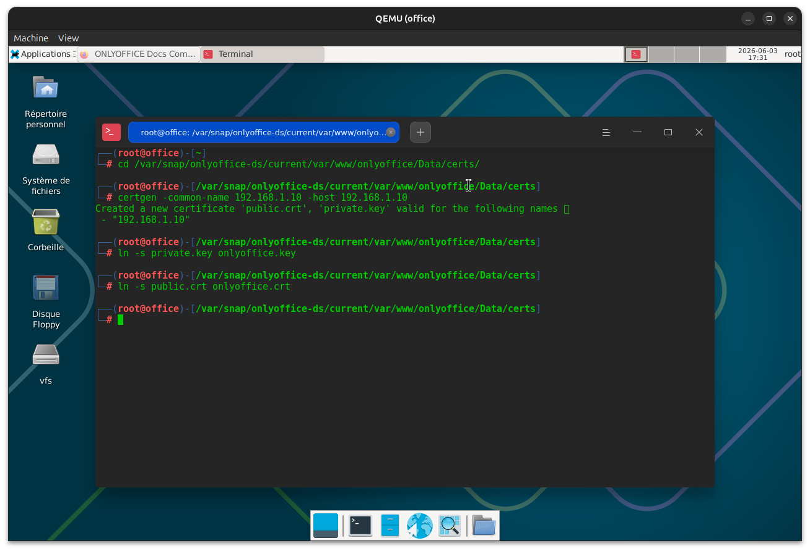

 
<!--QUESTION 69-->

**Now enable the HTTPS protocol for the OnlyOffice server by simply restarting the service**
 

Command to run on the office machine:

- snap restart onlyoffice-ds

 

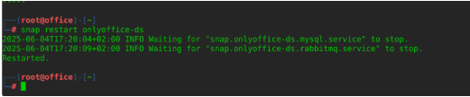

 

 
<!--QUESTION 70-->

**Reconnect to the OnlyOffice service and verify that it now uses the HTTPS protocol**
 

Steps:

1. Open a web browser  
2. Visit the OnlyOffice server using its IP address with `https://`  
   Example: `https://192.168.X.X`
3. Check for the padlock icon in the address bar to confirm HTTPS is active  
4. If prompted, accept the self-signed certificate (the browser may show a security warning)

 

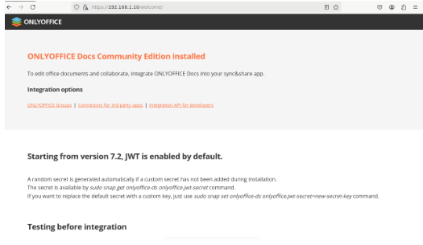

 

 
<!--QUESTION 71-->

**Add an exception to bypass the HTTPS security warning**
 

Because the TLS certificate is self-signed, most browsers will display a security alert.

To proceed:

1. Click on *Advanced* or *Details* in your browser's warning page  
2. Select *Accept the risk and continue* or equivalent option

This will allow you to access the OnlyOffice service over HTTPS, despite the self-signed certificate.

*PS : It's the same thing as https and ncloud*

### NextCloud Plugins
 

All actions in this section are to be performed from the Nextcloud administrator account
<!--QUESTION 72-->

**Learn about the procedure for installing a plugin (app) on the Nextcloud service**
 

To install a plugin (also called an app) in Nextcloud:

1. Log in as an administrator  
2. Click on your profile icon (top-right) and select *Apps* from the dropdown menu  
3. Browse or search for the desired app (e.g., OnlyOffice)  
4. Click *Download and enable* to install it  
5. The app will be added to your Nextcloud instance and available for configuration

Apps extend Nextcloud’s functionality and can include integrations, themes, or new features.

#### OnlyOffice 
 
<!--QUESTION 73-->

**Install the ONLYOFFICE plugin and configure it using the following information**
 

1. Log in to Nextcloud as an administrator  
2. Go to the *Apps* section  
3. Search for `ONLYOFFICE` and click *Download and enable*  
4. Once installed, go to *Settings > ONLYOFFICE* in the admin panel

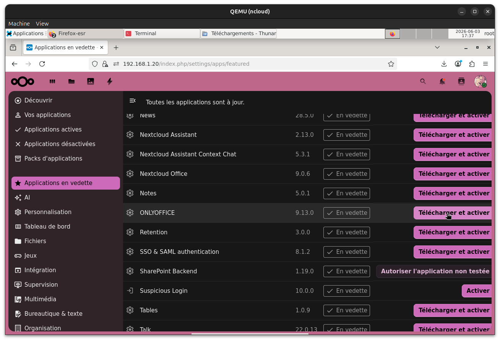

Fill in the following configuration:

- Document Editing Service address: `https://(office_ip)`
- Disable certificate verification: *check this box*
- Secret key: `(secret)` (the same one configured on the OnlyOffice server)

Click *Save* to apply the configuration.

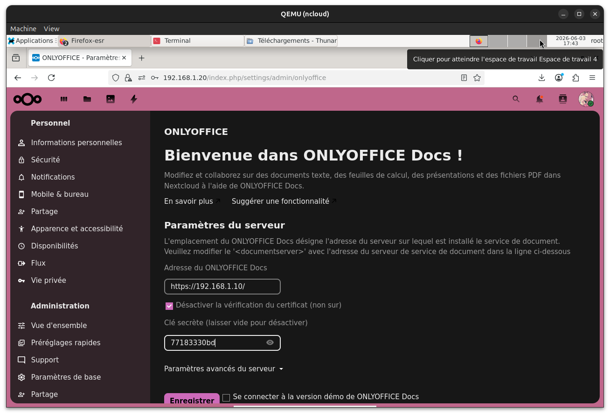

 
<!--QUESTION 74-->

**Enable the ONLYOFFICE plugin for the following file extensions**
 

In the Nextcloud admin interface, under *Settings > ONLYOFFICE*:

- Add or confirm the following supported file formats:
  - `doc`, `docx`, `ppt`, `pptx`, `xls`, `xlsx`, `odp`, `ods`, `odt`

This ensures that OnlyOffice will be used to open and edit these file types in the browser.

 

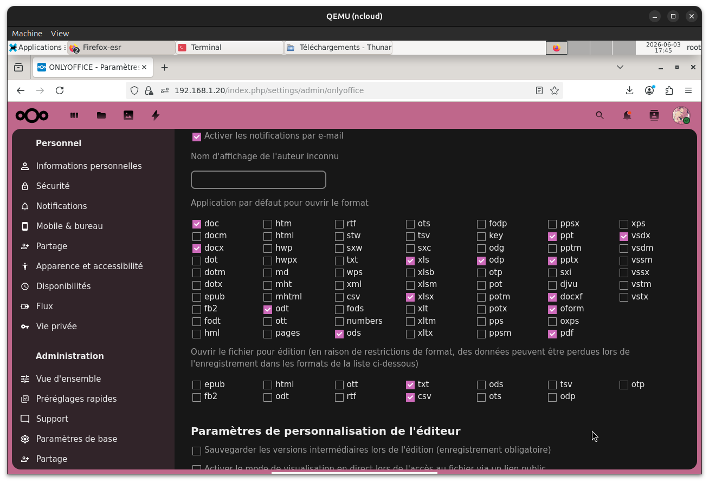

 
<!--QUESTION 75-->

**Open one of these document types from a user account to verify that the service works correctly**
 

Steps:

1. Log in as a regular user (e.g., alice or bob)  
2. Upload a file with one of the supported extensions  
3. Click on the file to open it

The document should now be editable directly in the browser using OnlyOffice.

Note:  
The service *does not work* with the *administrator account*. You must use a standard user account to test the integration.
 

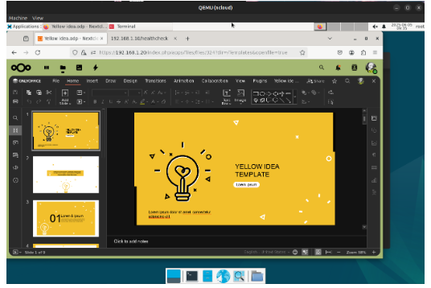

 

#### Splash

 
<!--QUESTION 76-->

**Install the Splash plugin**
 

1. Log in to Nextcloud as an administrator  
2. Go to the *Apps* section  
3. Search for `Splash`  
4. Click *Download and enable*

This plugin customizes the appearance of the login screen with a background image or color.

 

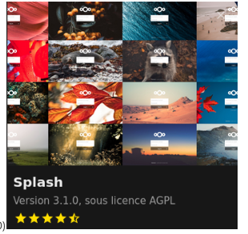

 
<!--QUESTION 78-->

**Configure Wallhaven**

Just follow the exemple at this point it's pretty obvious

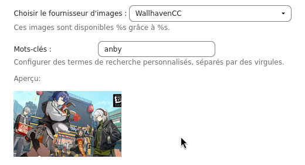

 

 
<!--QUESTION 78-->

**Verify that the Splash plugin is working correctly on the login screen**
 

1. Log out from your account  
2. View the login screen  
3. Check that the background and layout reflect the changes introduced by the Splash plugin

If the background has changed or a custom welcome screen is shown, the plugin is working correctly.

 

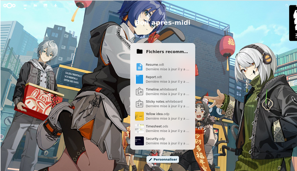

 

#### Passwords
 
<!--QUESTION 79-->

**Install the password manager plugin `Passwords`.**
 

1. Log in to Nextcloud as an administrator  
2. Go to the *Apps* section  
3. Search for `Passwords`  
4. Click *Download and enable*

This plugin adds a full-featured password manager for storing, organizing, and sharing passwords securely.

 

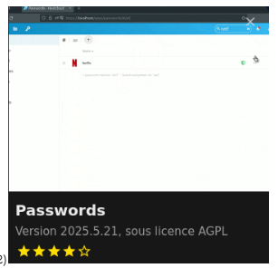

 
<!--QUESTION 80-->

**Verify that the plugin works correctly by creating and sharing a few passwords between the users alice and bob.**
 

1. Log in as `admin`  
2. Open the *Passwords* app from the sidebar  
3. Create a few password entries (e.g., for test services or websites)  
4. Use the share option to grant access to `bob`  
5. Log in as `bob` and open the *Passwords* app  
6. Confirm that the shared passwords from alice are visible and accessible

 

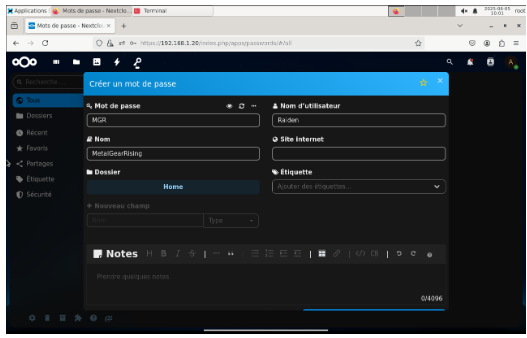
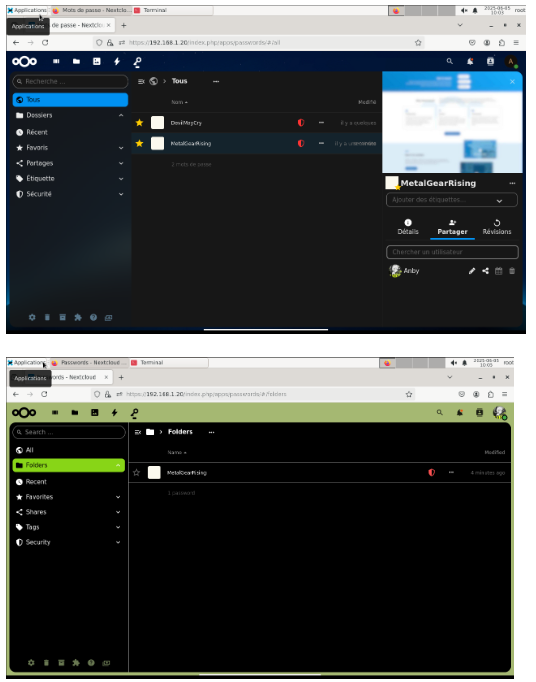
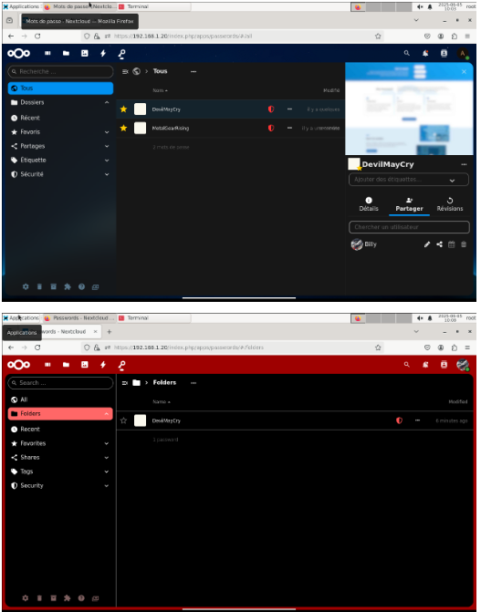

 

#### Secrets

 

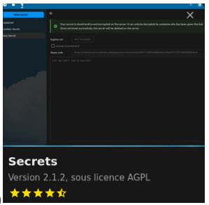

 
<!--QUESTION 81-->

**Install the secret manager plugin `Secrets`**
 

1. Log in to Nextcloud as an administrator  
2. Go to the *Apps* section  
3. Search for `Secrets`  
4. Click *Download and enable*

This plugin allows users to create, store, and securely share secret notes, tokens, or credentials.
 

 
<!--QUESTION 82-->

**Verify that the plugin is working by creating and sharing a few secrets, and attempt to access one anonymously using the provided URL**
 

1. Log in as `admin`  
2. Open the *Secrets* app from the sidebar  
3. Create a few secrets (e.g., API keys, personal notes)  
4. Share at least one secret using the *public link* option  
5. Copy the generated URL  
6. Open a private/incognito browser window  
7. Paste the link and check if the secret is viewable without logging in

This confirms the plugin’s ability to share sensitive information securely and anonymously when needed.

 

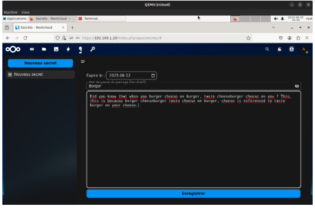
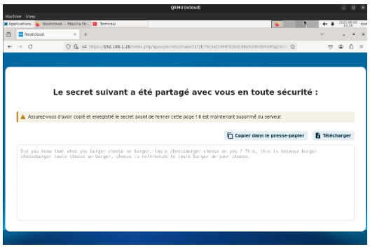

 

#### Draw.io

 

 
<!--QUESTION 83-->

**Install the Draw.io drawing plugin**
 

1. Log in to Nextcloud as an administrator  
2. Go to the *Apps* section  
3. Search for `Draw.io` or `drawio`  
4. Click *Download and enable*

This plugin integrates the Draw.io editor directly into Nextcloud, allowing users to create and edit diagrams (e.g., flowcharts, UML, mind maps) within the interface.

 

 
<!--QUESTION 84-->

**Verify that the Draw.io plugin works correctly by editing a diagram directly from the web browser**
 

1. Log in as a regular user (e.g., alice or bob)  
2. Go to the *Files* section  
3. Click *+* (new) and choose to create a new `Draw.io diagram`  
4. Name the file and confirm

The diagram editor should open in the browser, allowing you to create and modify shapes, connectors, and text.  
Make some changes, save the file, and reopen it to confirm that edits are preserved.
 

#### Calendar

 
<!--QUESTION 85-->

**Install the Calendar plugin**
 

1. Log in to Nextcloud as an administrator  
2. Go to the *Apps* section  
3. Search for `Calendar`  
4. Click *Download and enable*

This plugin adds a calendar interface where users can manage personal and shared events.

 

 
<!--QUESTION 86-->

**Create a shared calendar for the IUT group**
 

1. Log in as `alice` (who has admin rights over the IUT group)  
2. Go to the *Calendar* app  
3. Click *+ New calendar*  
4. Name it (e.g., `IUT Group Calendar`)  
5. After creation, open the sharing settings  
6. Share the calendar with the group `IUT` and grant *write* permissions

 

 
<!--QUESTION 87-->

**Verify that the calendar works correctly by creating events from the alice and bob accounts**
 

1. Log in as `alice` and create one or more events in the shared calendar  
2. Log in as `bob`  
3. Open the *Calendar* app and verify that alice’s events are visible  
4. Create new events as `bob` and confirm that they also appear in the shared calendar

This confirms that the shared calendar is accessible and editable by all group members.

 

#### FormVox

 

 
<!--QUESTION 89-->

**Install the FormVox plugin**
 

1. Log in to Nextcloud as an administrator  
2. Go to the *Apps* section  
3. Search for `FormVox`  
4. Click *Download and enable*

The FormVox plugin allows users to create surveys, questionnaires, or polls and collect responses directly within Nextcloud.

 
<!--QUESTION 90-->

**Create a simple form**
 

1. Log in as a regular user (e.g., alice or bob)  
2. Open the *FormVox* app from the sidebar  
3. Click *+ New form*  
4. Add a title and a few questions (e.g., multiple choice, short answer, etc.)  
5. Click *Publish* to make the form accessible

 

**Verify that the form works and that results can be collected and exported**
 

1. Open the published form in a browser (logged out or with another account)  
2. Fill out and submit the form  
3. Log back in as the form owner  
4. Open the form and check the *Results* tab  
5. Confirm that responses are visible and use the export feature (CSV) to extract the results

This confirms that the form can collect responses and that data can be reviewed or exported successfully.

 

 

<!--QUESTION 91-->

#### Additional Plugins

**Install and configure two additional plugins of your choice: Polls and 2048**
 

**Install the Polls plugin**
 

1. Log in to Nextcloud as an administrator  
2. Go to the *Apps* section  
3. Search for `Polls`  
4. Click *Download and enable*

This plugin allows users to create polls for scheduling, voting, or quick decisions among users.

 

 

**Create a simple poll**
 

1. Log in as a regular user (e.g., alice or bob)  
2. Open the *Polls* app from the sidebar  
3. Click *+ New poll*  
4. Add a question (e.g., "When should we meet?")  
5. Add options (e.g., time slots or answers)  
6. Click *Create* and configure sharing settings if needed

 

 

**Verify that the poll works correctly**
 

1. Open the poll with another account (e.g., bob if created by alice)  
2. Submit a response  
3. Log back in as the poll creator  
4. Check the *Results* tab to view votes and participation

This confirms that users can vote and results are recorded as expected.

 

 
<!--QUESTION 87-->
 

**2. Install 2048**

2048 is a game plugin that adds a simple tile-based puzzle game inside Nextcloud.

Steps:
- Still as an administrator, go to *Apps*  
- Search for `2048`  
- Click *Download and enable*  
- Log in as a user, go to the *2048* app in the sidebar, and start playing

These plugins demonstrate how Nextcloud can be extended for both productivity and leisure.

### Installing and Configurating clients

 
<!--QUESTION 92-->

All actions in this section are to be performed on the machines alice and bob using their respective user accounts.

To simplify file synchronization, we will install the official Nextcloud desktop sync client.

**Install the Nextcloud desktop client on both client machines using apt**
 

- sudo apt update
- sudo apt install nextcloud-desktop

*PS : We need to install everything on Bob and Alice, we start with bob*

 
<!--QUESTION 93-->
**Configure the synchronization client to use a directory of your choice**
 

Launch the Nextcloud desktop client

Enter the Nextcloud server address (e.g., https://192.168.X.X)

Log in with the respective user credentials (alice or bob)

When prompted, choose a local directory to sync with the cloud (e.g., ~/Nextcloud or any custom folder)

Confirm the synchronization settings

 

  <!--QUESTION 94-->
**Test the synchronization by creating and accessing files from both the web interface and the synced local directory**
 

From the web interface, log in as alice or bob and upload a file

On the client machine, check that the file appears in the synced folder

Create a new file or folder locally on the machine in the sync directory

Refresh the web interface and confirm the changes are reflected in real time

This confirms that two-way sync is working correctly.

*PS : We'll create a repository in alice's machine*

Then, on the ncloud machine, I connect to Alice (in Nextcloud), and we can see that the directory has been added

Now let's see if the reverse works too

I'm creating this repository in nextcloud

And on alice, what do we see? An apparition

Thanks you for reading this awesome and pretty unique tutorial, hopefully you were able to reach until the end 🎉

